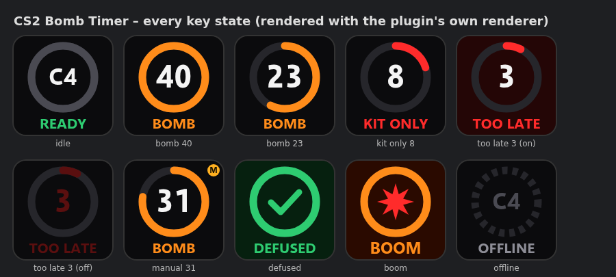

# Cs2-C4timer-Ulanzi-Plugin
 First off all, I'm not a dev, I'm just a player that developed it with AI help.
 https://cast-and-llix.github.io/Cs2-C4timer-Ulanzi-Plugin/
 
 A Ulanzi Studio plugin that turns one D200 key into a Counter-Strike 2 C4 timer. 

# CS2 Bomb Timer for the Ulanzi D200

A Ulanzi Studio plugin that turns one D200 key into a Counter-Strike 2 C4 timer. When the bomb is planted the key starts at **40** and counts down inside a shrinking ring. Counter-Strike 2 starts it automatically through Game State Integration (GSI).

| Time left | Ring | Label |
|---|---|---|
| more than 10 s | orange | **BOMB** |
| 6 – 10 s | red | **KIT ONLY** (only a kit defuse, which takes 5 s, can still make it) |
| 5 s or less | red, **flashing** | **TOO LATE** |
| round ends | green check / red burst | **DEFUSED** / **BOOM** for 4 s, then **C4 / READY** |
| backend not running | dashed grey | **OFFLINE** |



Pressing the key **starts or stops a manual 40 s countdown**, which is useful for testing. A small amber **M** badge shows while it runs. The manual countdown works even when the backend is offline. If a real plant comes in from CS2, it replaces the manual countdown.

```
CS2 ──GSI POST──▶ bomb_timer.py (127.0.0.1:3000) ◀──GET /state ×5/s── Ulanzi plugin ──▶ D200 key
```

---

## Contents

```
com.ulanzi.cs2bombtimer.ulanziPlugin/   ← the Ulanzi Studio plugin (copy this whole folder)
  manifest.json                         plugin + action metadata (Ulanzi SDK format)
  en.json                               English strings
  plugin/app.html                       main service (loaded by Ulanzi Studio's WebView)
  plugin/app.js                         websocket events, polling, per-key instances
  plugin/actions/bombLogic.js           pure state machine (unit-tested under Node)
  plugin/actions/bombRenderer.js        canvas drawing: ring, number, label
  property-inspector/timer/             settings panel (backend URL, bomb time, result time, live status)
  libs/                                 official Ulanzi common-html SDK (Apache-2.0, unmodified)
  assets/icons/                         plugin / action / default key icons
backend/bomb_timer.py                   GSI listener + /state JSON (Python standard library only)
cs2/gamestate_integration_bomb.cfg      GSI config for CS2
tools/mock_gsi.py                       fake CS2 round, for testing without the game
tools/preview.html                      every key state, plus a live preview that polls /state
tests/                                  Python + Node unit tests
```

---

## Setup

### 1. CS2 GSI config
Copy `cs2/gamestate_integration_bomb.cfg` into the CS2 cfg folder:

- **Windows:** `C:\Program Files (x86)\Steam\steamapps\common\Counter-Strike Global Offensive\game\csgo\cfg\`
- **macOS/Linux:** `…/steamapps/common/Counter-Strike Global Offensive/game/csgo/cfg/`

Restart CS2 after copying (it only reads GSI files at startup). The file name must start with `gamestate_integration_`.

### 2. Backend
Requires Python 3.8 or newer. No packages are needed.

```bash
python backend/bomb_timer.py            # listens on http://127.0.0.1:3000
python backend/bomb_timer.py --voice    # + spoken "Bomb planted / Kit only / Too late / Bomb defused"
```

| Option | Default | |
|---|---|---|
| `--port` | `3000` | used both for the GSI POSTs and for `GET /state` |
| `--token` | `CS2BOMBTIMER` | must match `auth.token` in the .cfg; `--token ""` turns the check off |
| `--bomb-time` | `40` | C4 fuse length |
| `--voice` | off | uses pyttsx3 if installed (`pip install pyttsx3`), otherwise macOS `say` or Windows SAPI via PowerShell |
| `-v` | off | debug logging |

Check it is running: open <http://127.0.0.1:3000/state> in a browser.

### 3. Plugin
1. Quit Ulanzi Studio completely.
2. Copy the whole `com.ulanzi.cs2bombtimer.ulanziPlugin` folder into the Ulanzi Studio plugins folder:
   - **Windows:** `%APPDATA%\Ulanzi\UlanziDeck\Plugins\`
   - **macOS:** `~/Library/Application Support/Ulanzi/UlanziDeck/Plugins/` (if this folder doesn't exist on your Mac, look for the Ulanzi folder under Application Support)
3. Start Ulanzi Studio. **CS2 Bomb Timer → Bomb Timer** appears in the plugin list. Drag it onto a D200 key.
4. The key should show **C4 / READY**. If it shows **OFFLINE**, the backend isn't running, or the URL in the settings panel is wrong.

Requires Ulanzi Studio 2.1.4 or later (the same minimum as Ulanzi's own sample plugin).

---

## Testing without the game

```bash
python backend/bomb_timer.py
python tools/mock_gsi.py                                # plant, then BOOM at 0
python tools/mock_gsi.py --outcome defused --defuse-at 7
curl -X POST http://127.0.0.1:3000/manual/start         # backend-side 40 s countdown (also triggers voice)
curl -X POST http://127.0.0.1:3000/reset
```

To see every key state without a deck, open `tools/preview.html` in a browser. Its lower half polls `/state` the same way the plugin does.

Unit tests:
```bash
python -m unittest discover -s tests      # backend: 16 tests
node --test tests/bombLogic.test.js       # plugin logic: 15 tests
```

---

## `/state` JSON contract

```json
{
  "status": "planted",          // idle | planted | defused | exploded
  "time_remaining": 23.418,     // seconds (float) while planted, otherwise null
  "seconds": 24,                // ceil(time_remaining), what the key shows
  "phase": "bomb",              // bomb | kit_only | too_late while planted, otherwise = status
  "bomb_time": 40,
  "source": "gsi",              // gsi | manual | null
  "status_age": 16.58,          // seconds since status last changed
  "inferred": false,            // true = "exploded" assumed (no GSI event 2.5 s after 0)
  "gsi_connected": true,        // a GSI packet arrived in the last 30 s
  "last_gsi_age": 0.4,
  "round_phase": "live",
  "map": "de_mirage",
  "player_team": "CT",
  "server_time": 1793907686.7,
  "version": "1.0.0"
}
```

The plugin only needs `status` and `time_remaining`. It also accepts `state`, `remaining`, `time_left` or `countdown`, so an existing script that uses different field names will usually still work. `status_age` stops an old DEFUSED/BOOM from showing when the plugin starts up mid-round.

### Using your own `bomb_timer.py` instead
That works too. It just needs to send **`Access-Control-Allow-Origin: *`** on `/state`. Ulanzi Studio runs the plugin inside a Chromium WebView, and without that header the browser blocks the request, so the key shows **OFFLINE** even though the script is running. A mock deck usually doesn't enforce this, so this is a likely difference on real hardware.

---

## How it works

**Backend.** CS2 reports `round.bomb = planted / defused / exploded` to players, but not the countdown itself. The backend notes the moment of the plant and counts 40 s from there. If CS2 does send a countdown (`bomb.countdown` when spectating or on GOTV, or `phase_countdowns.phase == "bomb"`), the backend re-syncs to it. If the timer reaches 0 and no `exploded` event arrives within 2.5 s, the bomb is assumed to have exploded. When the next round starts (bomb gone from `round`), the state goes back to `idle`. The cfg uses `buffer 0` so the plant is sent immediately.

**Plugin.**
- It polls every 80 ms. Each request times out after 400 ms, and a new one is never started while the previous one is still waiting.
- Between polls it estimates the time left from the last value it received.
- The key image is only re-sent to the deck when what's shown changes: the number, the phase or the flash frame. A whole round takes about 45 image updates.
- The displayed number never goes back up by 1 because of timing jitter.
- If no poll has succeeded for 1.5 s, the key shows OFFLINE. One dropped poll doesn't trigger it.
- While the key's page isn't visible (`setactive false`) it stops sending images, and it redraws when the page becomes visible again.
- Timers use the SDK's worker-based `timers.js`, so the hidden WebView doesn't slow them down.

**Settings panel:** backend URL, bomb time, how long DEFUSED/BOOM stays on the key, and a live online/offline status.

---

## What has been tested (and what hasn't)

- ✅ Backend unit and HTTP tests (16) and plugin logic tests (15) all pass.
- ✅ **Official UlanziDeck Simulator** (from `UlanziTechnology/UlanziDeckPlugin-SDK`), using the real websocket protocol:
  - the main service connects
  - `add` draws C4 / READY
  - a mock GSI round shows BOMB → KIT ONLY → TOO LATE → DEFUSED and BOMB → … → BOOM, then READY
  - a `run` key press starts and stops the manual countdown
  - killing the backend shows OFFLINE
  - settings changes from the panel reach the main service
- ✅ Polling from a `file://` page in Chromium works, which confirms the CORS headers.
- ✅ **Tested on a real D200 and in the real Ulanzi Studio app, with a live CS2 match.** 

## License
Plugin code: MIT. `libs/` is Ulanzi's common-html SDK under Apache-2.0 (see `libs/LICENSE`).
